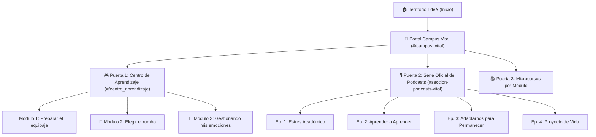

# 🌿 Guía de Usuario: Campus Vital & Centro de Aprendizaje
### Tecnológico de Antioquia — Institución Universitaria
**Departamento de Ciencias Básicas y Áreas Comunes (DCBAC) & Bienestar Universitario**

---

## 📌 1. Introducción y Enfoque de Bienestar

**Campus Vital** es la estrategia institucional del Tecnológico de Antioquia orientada al acompañamiento psicoeducativo, la salud mental, la permanencia estudiantil y la adaptación a la vida universitaria.

El ecosistema integra recursos multimodales diseñados bajo el **Diseño Universal para el Aprendizaje (DUA)**, permitiendo que cada estudiante avance a su propio ritmo, reflexione sobre su bienestar y construya herramientas prácticas para afrontar con serenidad y equilibrio los semestres académicos y los periodos de evaluación.



---

## 🚪 2. Cómo ingresar a Campus Vital

Existen dos maneras sencillas de acceder:

1. **Desde la página principal de Territorio TdeA (`#/home`):**
   - En la barra de búsqueda superior, haz clic en el chip rápido **`🌱 Campus Vital`**.
   - O en la cuadrícula de canales principales, haz clic en la tarjeta **`🌱 Bienestar y Salud Mental: Campus Vital`**.
2. **Acceso directo mediante enlace:**
   - Escribe o navega a la URL interna: `#/campus_vital`.

---

## 🗺️ 3. Recorrido por el Portal de Campus Vital

Al ingresar al portal encontrarás cuatro secciones organizadas pedagógicamente:

### 3.1. Barra de Navegación y Banner Institucional
- **Migas de pan (*Breadcrumbs*):** En la esquina superior izquierda puedes pulsar `🏠 Inicio` o la flecha `←` para volver a la pantalla principal en cualquier momento.
- **Botón Menú Principal:** Ubicado a la derecha para un retorno rápido.
- **Banner Verde:** Presenta la misión de Campus Vital y un botón directo: **`🎙️ Explorar Serie de Podcasts (4 Episodios) ↓`**, que te lleva de inmediato a los reproductores de audio.

---

### 3.2. Vitrina de Puertas de Entrada (Showcase Destacado)
En la parte superior se presentan las dos grandes experiencias interactivas en dos tarjetas gemelas verde esmeralda:

```
┌───────────────────────────────────────┐   ┌───────────────────────────────────────┐
│ ● Activo ahora  🎮 Entorno 3D         │   │ ● Disponible ahora  🎙️ 4 Episodios    │
│                                       │   │                                       │
│          [ 🤖 Mascota 3D ]            │   │      [ 🎙️ Mascota con Micrófono ]     │
│                                       │   │                                       │
│       Centro de Aprendizaje           │   │         Serie de Podcasts             │
│  Entorno lúdico y gamificado en 3D    │   │  Acompañamiento sonoro institucional  │
│  guiado por la mascota institucional. │   │  orientado por psicólogos de bienestar│
│                                       │   │                                       │
│ [ Ingresar al Centro de Aprendizaje →]│   │ [ Explorar Serie de Podcasts ↓ ]      │
└───────────────────────────────────────┘   └───────────────────────────────────────┘
```

1. **Tarjeta Izquierda — Centro de Aprendizaje:**
   - Muestra a la **mascota virtual en 3D** con su birrete académico saludando.
   - Al hacer clic en la tarjeta o en el botón **`Ingresar al Centro de Aprendizaje →`**, te transporta al entorno interactivo de los tres módulos.
2. **Tarjeta Derecha — Serie Oficial de Podcasts:**
   - Muestra a la **mascota locutora con audífonos y micrófono profesional de estudio** con halo neón.
   - Al pulsar la tarjeta o su botón **`Explorar Serie de Podcasts ↓`**, la página se desplaza suavemente hasta la sección de reproductores sonoros.

---

### 3.3. Sección de Microcursos por Módulo
Debajo de la vitrina encontrarás los microcursos formativos agrupados por tema:
- **Módulo 1: Autogestión del Aprendizaje:** Cápsulas audiovisuales y talleres descargables sobre hábitos de estudio.
- **Módulo 2: Adaptación a la Vida Universitaria:** Herramientas para la transición de la educación media a la superior.
- **Módulo 3: Gestionando mis emociones:** Introducción práctica a las 4 pausas conscientes para momentos de sobrecarga.

---

### 3.4. Serie Oficial de Podcasts de Bienestar
Una biblioteca sonora con 4 episodios completos conducidos por psicólogos de Bienestar Institucional:

| Episodio | Tema Central | Profesional a Cargo |
| :--- | :--- | :--- |
| **Episodio 1** | *El Estrés Académico: Estrategias para Gestionar la Presión y las Entregas* | Psic. Andrés Felipe Gómez |
| **Episodio 2** | *Aprender a Aprender: Hábitos de Estudio y Estrategias Efectivas* | Psic. Ana María & Psic. Andrés Felipe Gómez |
| **Episodio 3** | *Adaptarnos para Permanecer: Navegar la Transición Universitaria* | Psic. Andrés Felipe Gómez |
| **Episodio 4** | *Proyecto de Vida: Construir tu Propósito y Mantener la Motivación* | Psic. Ana María |

**Controles de cada podcast:**
- **Reproducir en línea:** Pulsa el botón verde `▶ Escuchar Podcast` para abrir el reproductor accesible con barra de tiempo, volumen y selector de velocidad (1x, 1.25x, 1.5x).
- **Descargar archivo MP3:** Pulsa `📥 Descargar (MP3)` para guardar el audio en tu celular o computador y escucharlo sin conexión a internet.

---

## 🎮 4. Guía Detallada del Centro de Aprendizaje 3D (`#/centro_aprendizaje`)

Al entrar al Centro de Aprendizaje serás guiado por nuestra mascota institucional a lo largo de 3 módulos temáticos:

### 4.1. Barra de Interacción con la Mascota
En el encabezado del Centro de Aprendizaje puedes interactuar con el robot institucional mediante botones de animación en tiempo real:
- 💫 **Saludar:** La mascota realiza un gesto de bienvenida.
- 🌀 **Giro 3D:** Realiza una rotación completa sobre su eje.
- 🤗 **Abrazo:** Mensaje visual de contención y calidez.
- 🎉 **Celebrar:** Efecto festivo de confeti sonoro para celebrar tus logros.

---

### 4.2. Módulo 1: Preparar el equipaje (Autogestión y Autocuidado)
Este módulo se enfoca en reconocer tus recursos internos antes de iniciar o continuar tu viaje universitario.

1. **Estación 1: Estación del Clima Emocional**
   - **Paso 1 (Tu clima interno):** Selecciona el ícono que mejor describe cómo te sientes hoy: *Soleado ☀️*, *Nublado ⛅*, *Lluvioso 🌧️* o *Tormenta ⛈️*, y escribe una breve nota reflexiva.
   - **Paso 2 (Rueda de Bienestar):** Marca las áreas de tu vida que requieren mayor atención (sueño, alimentación, relaciones, finanzas, tiempo libre, etc.).
   - **Paso 3 (Grabación de Audio Reflexivo):** Puedes grabar tu propia voz reflexionando sobre tu clima, pausar, escucharla y descargar el archivo MP3.
2. **Estación 2: El Valor del Error y las Rutas Alternativas**
   - Análisis guiado del caso de estudio de Daniel.
   - Reflexión sobre el error como oportunidad formativa en lugar de fracaso definitivo.
3. **Estación 3: La Red de Acompañamiento**
   - **Lienzo Digital Interactivo:** Un tablero centrado donde puedes estampar nodos interactivos (Familia, Amigos, Docentes, Compañeros, Psicología, Bienestar TdeA) para trazar tu red de apoyo.
   - **Directorio de Servicios TdeA:** Información de contacto institucional de apoyo estudiantil.
   - **Maleta de Bienestar:** Infografía animada en Canva con tus recursos de viaje.
   - **Bitácora del Viajero:** Pregunta reflexiva final: *«¿Qué herramienta de mi maleta creo que utilizaré primero y por qué?»*.
4. **Cierre del Módulo 1:** Tarjeta oficial «Has recorrido la primera parte de este viaje» con descarga de infografía de síntesis en PDF y botón de avance al Módulo 2.

---

### 4.3. Módulo 2: Elegir el rumbo (Metas y Proyecto de Vida)
Diseñado para conectar tu carrera académica con tu vocación y tus metas vitales.

- **Ruta 1 — Mi Proyecto de Vida:**
  - Infografía interactiva: *Las 4 Claves del Proyecto de Vida*.
  - **Árbol de la Vida Universitario:** Lienzo reflexivo donde exploras tus raíces (origen y valores), tronco (fortalezas), ramas (metas académicas) y frutos (logros anhelados).
  - Planteamiento de metas con metodología SMART (específicas, medibles y alcanzables).
  - Descarga consolidada de tu Ficha de Proyecto de Vida.
- **Ruta 2 — Adaptación Universitaria:**
  - Termómetro interactivo de transición institucional.
  - Estrategias de gestión del tiempo y rutinas saludables.

---

### 4.4. Módulo 3: Gestionando mis emociones (4 Pausas Conscientes)
Un gimnasio emocional para recuperar la calma en semanas de alta exigencia académica:

#### 🧘 Pausa 1: Escáner Corporal Somático
- Mapa interactivo de silueta anatómica.
- Haz clic sobre las zonas donde sueles somatizar la tensión (cabeza/mandíbula, cuello/garganta, pecho/respiración, estómago o espalda/hombros).
- Observa la respuesta térmica y registra tus notas corporales.

#### 🫁 Pausa 2: Respiración Consciente (Ritmo 4 - 2 - 6)
- **Técnica visual guiada:**
  1. *Inhala* durante 4 segundos mientras el círculo se expande.
  2. *Sostén* el aire durante 2 segundos.
  3. *Exhala* suavemente durante 6 segundos mientras el círculo se contrae.
- Contador automático de ciclos completados y retroalimentación calmante.

#### 🚦 Pausa 3: Semáforo Emocional (Haciendo una pausa consciente)
- Video locución explicativo de la técnica.
- **Semáforo Interactivo con Caso de Estudio (Valentina ante el examen final):**
  - Toca cada luz del semáforo para desplegar y resolver sus preguntas:
    - 🔴 **ROJO (Me detengo):** Reconocer la reacción impulsiva antes de actuar.
    - 🟡 **AMARILLO (Observo):** Identificar pensamientos catastrofistas y sensaciones corporales sin juzgarlos.
    - 🟢 **VERDE (Elijo):** Seleccionar acciones concretas de afrontamiento consciente.
  - Las lámparas se iluminan con un halo resplandeciente y reciben una marca de verificación (`✓`) a medida que completas cada fase.

#### 🧰 Pausa 4: Volviendo al Presente y Mi Caja de Herramientas
- **Técnica Sensorial de Anclaje 5-4-3-2-1:** Ejercicio guiado para conectar con los 5 sentidos ante la ansiedad anticipatoria.
- **Mi Caja de Herramientas para Volver a la Calma:** Selección personalizada de tus técnicas preferidas y generación de tu ficha resumen descargable para llevar siempre contigo.

---

## 💾 5. Preguntas Frecuentes sobre Almacenamiento y Privacidad

> [!NOTE]
> **¿Dónde se guardan mis respuestas y reflexiones?**  
> Se guardan de manera automática y privada en el almacenamiento local de tu propio navegador (`localStorage`). No se transmiten a servidores externos sin tu consentimiento, garantizando estricta confidencialidad sobre tu estado emocional y salud mental.

> [!TIP]
> **¿Cómo guardo una copia de mis actividades para entregársela a un docente o consejero?**  
> Al final de cada módulo y estación encontrarás botones de **Descargar PDF** o **Descargar Audio MP3**. Al pulsarlos, se genera un archivo descargable con todas tus respuestas consolidadas que puedes adjuntar por correo institucional o Teams.

> [!IMPORTANT]
> **¿Qué pasa si cierro el navegador o se apaga mi dispositivo?**  
> Tu progreso se preserva intacto. Al volver a ingresar desde el mismo dispositivo y navegador, encontrarás tus selecciones, notas y estados completados exactamente donde los dejaste.

---

## 📞 6. Canales de Ayuda y Orientación Personalizada

Si estás experimentando una situación difícil, estrés excesivo o requieres orientación personalizada:

* **Mesa de Ayuda de Ciencias Básicas:** Correo oficial [`cienciasbasicas@tdea.edu.co`](mailto:cienciasbasicas@tdea.edu.co)
* **TutorIA TdeA:** Panel de tutoría inteligente accesible desde el botón flotante en la esquina superior derecha.
* **Bienestar Institucional TdeA:** Servicios presenciales y virtuales de acompañamiento psicoeducativo en el campus institucional.

